# エンジンごとのレビュー処理

レビューのとき、3 つのエージェントエンジン (OpenCode / pi / ADK) がそれぞれ中で何をしているか。
エンジンを選んだ理由と比較は [agent-engine.md](agent-engine.md)、
Webhook から投稿までの全体の流れは [review-flow.md](review-flow.md) にある。
この文書が扱うのは、worker が `reviewer.Engine.Run` を呼んでから戻るまでの間。

> 図は Mermaid で書いてある。GitHub 上ではそのまま図として表示される。

## 1. エンジンの位置

worker はエンジンの違いを知らない。PR の取得、チェックアウト、トリアージ、出力の検証、投稿は
すべて worker が行い、エンジンに頼むのは「プロンプトを渡して、出力ファイルを書かせる」ことだけ。

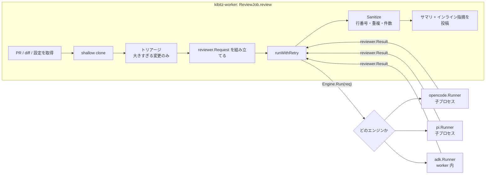

### どのエンジンで動くか

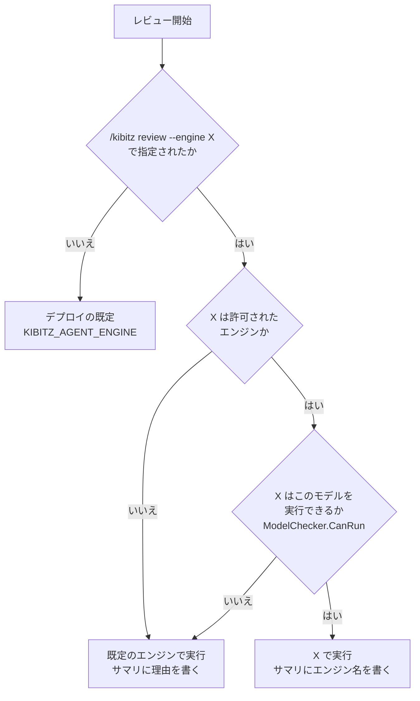

- 既定は `KIBITZ_AGENT_ENGINE` (`opencode` / `pi` / `adk`)。
- コメントで切り替えられるのは、デプロイが許可したエンジンだけ。
  切り替えたエンジンで動いたレビューのセッションは保存しない。続く質問 (answer) は既定のエンジンで動き、
  別のエンジンのセッションは開けないため。
- `CanRun` を持つのは ADK だけ (Gemini 以外を拒否)。
- トリアージも同じエンジンで動く。ただしコマンドで ADK を指定し、トリアージ用のモデルが Gemini でない場合は、
  トリアージだけ既定のエンジンで動く (`ReviewJob.triageEngine`)。

## 2. 3 エンジンに共通する手順

3 つの `Run` は、骨格が同じになるように書いてある。違うのは「エージェントをどう動かすか」と
「権限をどう作るか」の部分だけ。

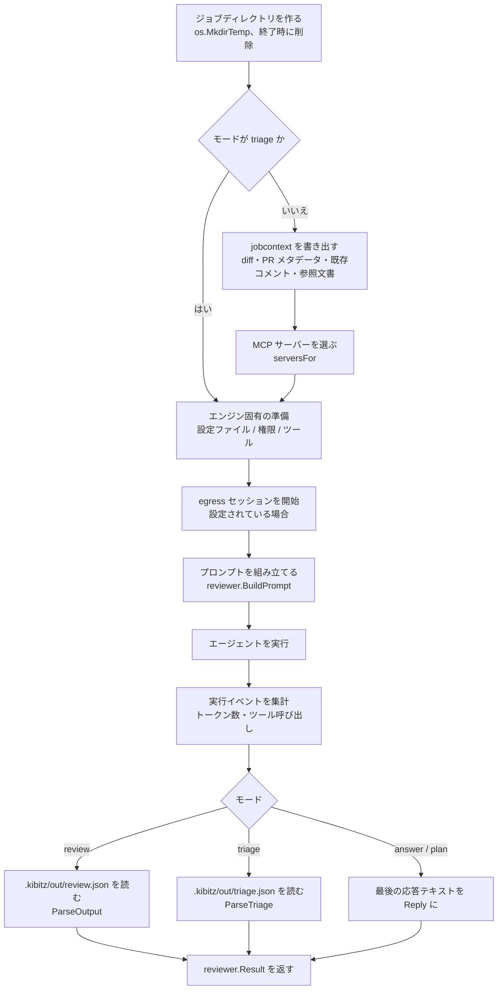

### MCP サーバーの選び方 (`serversFor`)

3 エンジンとも同じ規則で選ぶ。

1. トリアージには何も渡さない (ファイル名の一覧だけで判断させるため)。
2. リポジトリの `.kibitz.yaml` が名前を挙げたサーバーのうち、デプロイのカタログにあるものだけ。
3. fork からの PR では、`allow_fork: true` のサーバーだけ。
4. jobcontext があれば、kibitz 自身の `kibitz-mcp` (`kibitz` という名前) を必ず足す。
   `get_pr_diff` / `list_pr_files` / `list_pr_comments` / `get_pr_metadata` / `search_docs` / `get_doc` を持ち、
   トリアージで外したファイルの diff もここから読める。

### 出力の契約と、失敗したときの再試行

review の結果は**ファイル** (`.kibitz/out/review.json`) で受け取る。標準出力のテキストは読まない。
JSON として読めない・スキーマに合わない場合、エンジンは `reviewer.OutputError` を返す。
worker はそのときだけ 1 回やり直す。

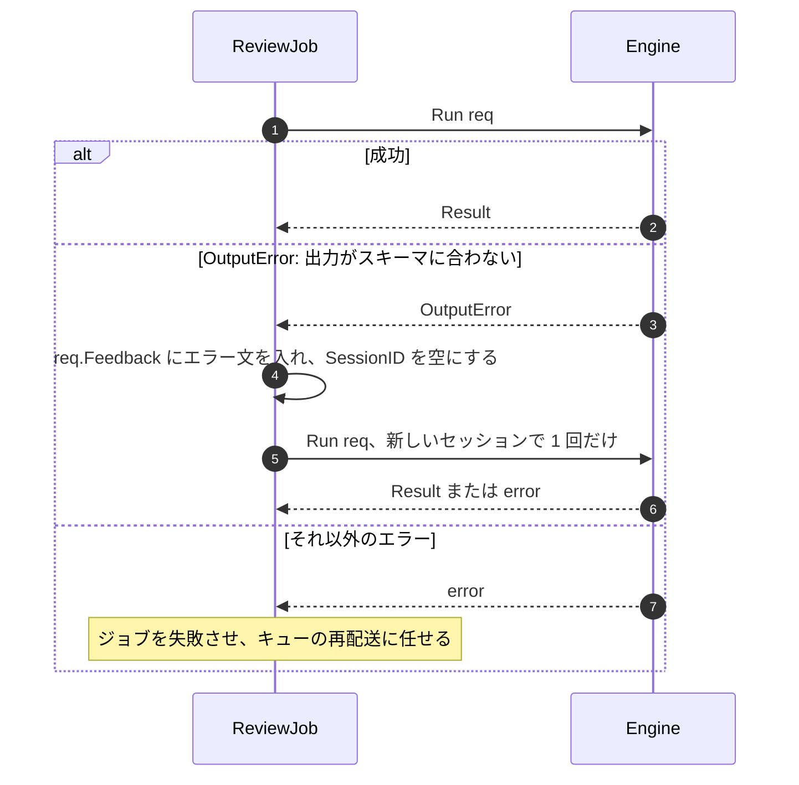

戻った `Result` は、どのエンジンのものでも `reviewer.Sanitize` が同じように検証する
(diff の外の行・重大度の閾値・重複・件数の上限)。

## 3. OpenCode (`KIBITZ_AGENT_ENGINE=opencode`、既定)

実装は `internal/reviewer/opencode`。**`opencode run` を 1 ジョブにつき 1 プロセス起動する。**
権限は OpenCode 自身の `permission` 設定で作り、その設定はジョブごとに kibitz が生成する。

### プロセスの構成

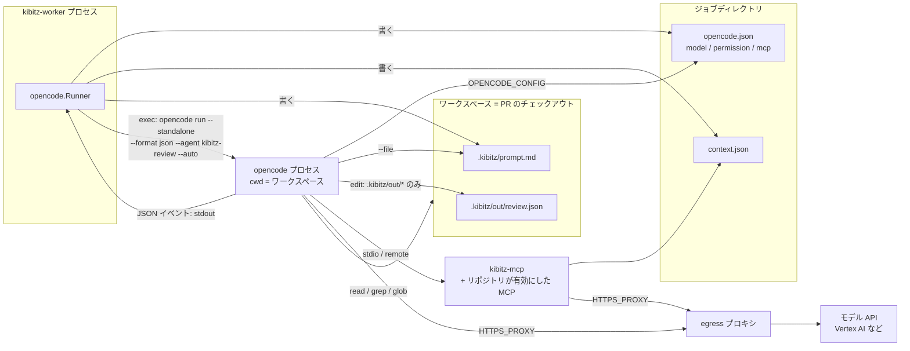

### 実行の流れ

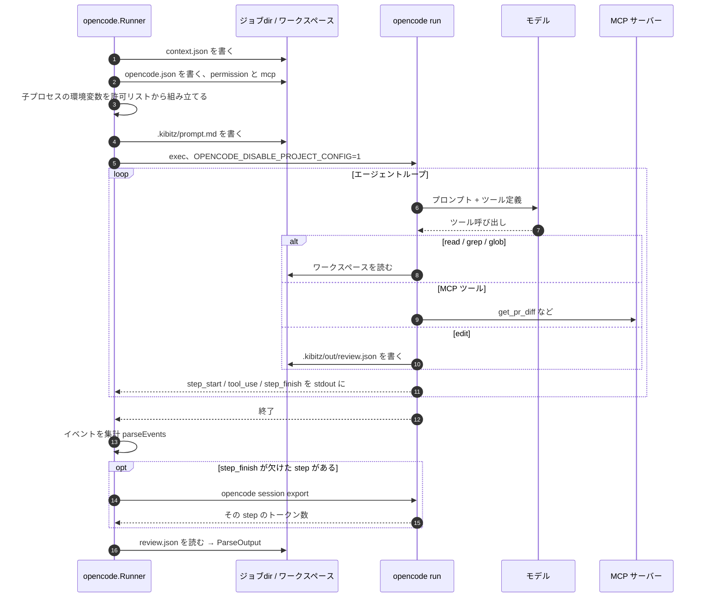

### 権限 (`opencode.json` の `permission`)

ジョブごとに生成し、リポジトリ側の設定は読まない (ADR-0010)。

| ツール | review | answer / plan | triage |
| --- | --- | --- | --- |
| `*` (下に無いもの全部) | deny | deny | deny |
| `read` / `grep` / `glob` | allow | allow | allow |
| `edit` | `.kibitz/out/*` だけ allow | deny | `.kibitz/out/*` だけ allow |
| `bash` / `webfetch` / `external_directory` | deny | deny | deny |
| MCP サーバーのツール | サーバー名で allow | サーバー名で allow | (サーバー自体を渡さない) |

- **シェルはどのモードにも無い。** `bash` のルールはコマンドライン文字列への一致なので、
  1 つのプログラムを許すとそのオプションを全部許すことになるため。
- `--auto` は必須。`ask` が 1 つでも残ると、ヘッドレスでは承認待ちのまま止まる。
- MCP は OpenCode 2 の形式で書き、サーバーごとに `codemode: false` を付ける。
  付けないと 2.0 の既定の Code Mode になり、`"*": "deny"` で `execute` が拒否されて、ツールが 1 つも使えなくなる。

### チェックアウトから何も読ませない

PR のチェックアウトにある `AGENTS.md`、`.opencode/`、`.claude/`、`.agents/` を読ませないよう、
`OPENCODE_DISABLE_PROJECT_CONFIG=1` を付けて起動する。読まれると、ブランチ側がレビュアーへの指示を書き換えられてしまう。
リポジトリの規約は worker がデフォルトブランチから読み、プロンプトの `Guidelines` として渡す。

### 途中で止まったときの扱い

OpenCode には、ほかの 2 つに無いやり直しの経路が 2 つある。

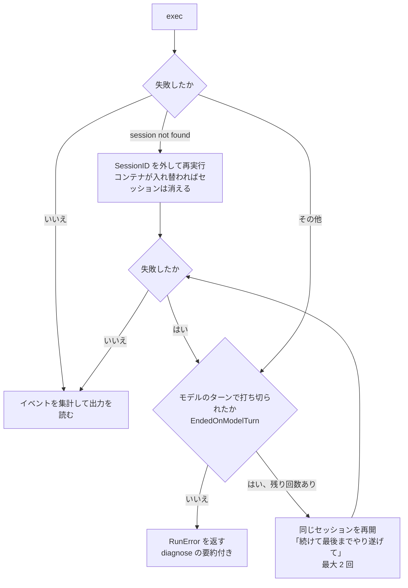

- **モデルのターンでの打ち切り**: Gemini が `OTHER` や `UNEXPECTED_TOOL_CALL` などの終了理由を返すと、
  OpenCode はモデル自身の発言で終わる会話をもう一度送ってしまい、Vertex AI に拒否される。
  これを `diagnose.go` で見分け、セッションを再開する。打ち切られた回のトークンも合算する。
- **トークン数の取りこぼし**: OpenCode 2 の `run --format json` は最後の `step_finish` を出さないことがある。
  そのため `opencode session export` で該当する step だけを読み直す (`recoverUsage`)。
- **失敗の診断**: stdout のイベントと stderr のログから、失敗の原因を 1 行にまとめる (`diagnose.go`)。
  その 1 行が失敗通知のコメントに出る。

## 4. pi (`KIBITZ_AGENT_ENGINE=pi`、試作)

実装は `internal/reviewer/pi`。OpenCode と同じく **`pi` を 1 ジョブにつき 1 プロセス起動する。**
違いは権限の作り方にある。pi には権限機構が無いので、次の 2 段で作る。

1. **そもそも渡さない**: settings.json の `defaultTools` で、モードに必要なツールだけを有効にする。
2. **呼び出しごとに検査する**: ガード拡張 `deploy/pi/kibitz-guard.ts` が、`tool_call` のたびにツール名・パス・書き込み先を確かめる。

### プロセスの構成

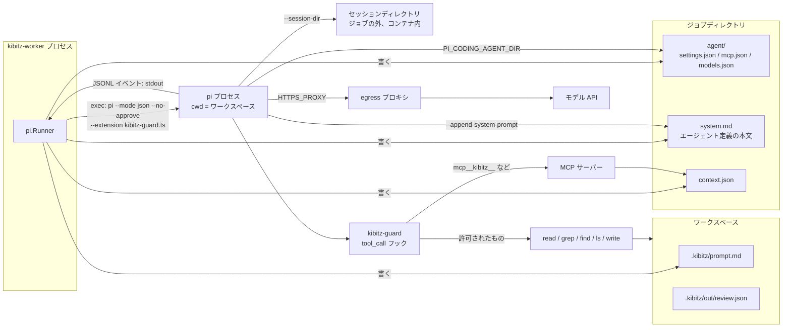

### 実行の流れ

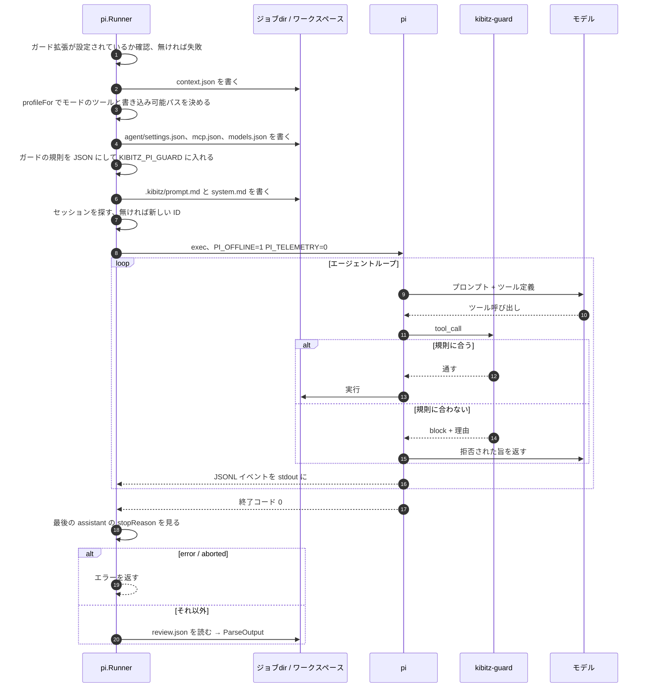

### モードごとのツール (`profileFor`)

| モード | 有効にするツール | 書き込める場所 |
| --- | --- | --- |
| review / triage | `read` `grep` `find` `ls` `write` | `^\.kibitz/out/[^/]+$` |
| answer / plan | `read` `grep` `find` `ls` | なし |
| implement | 上の 4 つ + `edit` `write` | リポジトリが許したパス (`repoconfig.PathFilter` の正規表現) |

MCP のツールは `mcp__<サーバー名>__` という接頭辞で許可する。
ツールを絞るのに `--tools` を使わないのは、`--tools` だと MCP のツールまで落ちてしまうから。

### ガード拡張が確かめること

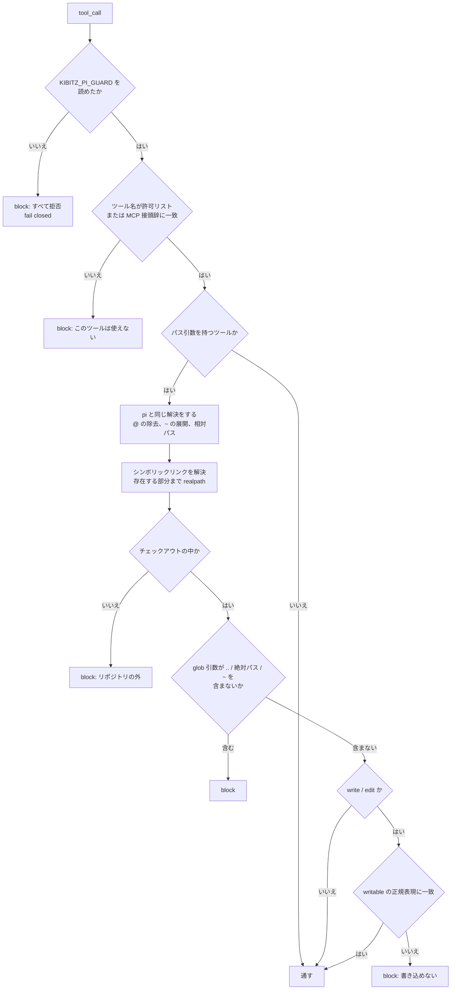

### チェックアウトから何も読ませない

`--no-approve` (project trust を与えない)、`--no-context-files` (`AGENTS.md` / `CLAUDE.md`)、
`--no-skills`、`--no-prompt-templates` を付ける。`~/.pi/agent` に当たるものはジョブディレクトリに作り、
`PI_CODING_AGENT_DIR` でそこを指す。そのため、運用者の設定も前のジョブの設定も効かない。

### セッション

pi は ID によるセッション検索を起動ディレクトリ単位で行う。毎回新しいチェックアウトで起動するので、ID では見つからない。
そこでセッションファイルをジョブの外の `--session-dir` に置き、続きのときは `*_<id>.jsonl` を探して
`--session <file>` で開く。新しいときは `kibitz-<乱数>` を `--session-id` で渡す。

### OpenCode との違い

- プロバイダのエラーでも pi は終了コード 0 で終わる。そのため最後の assistant メッセージの `stopReason` で失敗を判定する。
- 応答が打ち切られたときの再開と、`diagnose.go` に当たる詳しい診断はまだ無い。

## 5. ADK for Go (`KIBITZ_AGENT_ENGINE=adk`、試作)

実装は `internal/reviewer/adk`。**子プロセスを起動しない。** エージェントループ、ツール、モデルのクライアントがすべて
worker のプロセスの中で動く。そのため安全性の根拠も変わる。権限設定で「禁止」するのではなく、
「kibitz が書いたツールしか存在しない」ことと `os.Root` の閉じ込めが根拠になる。

### プロセスの構成

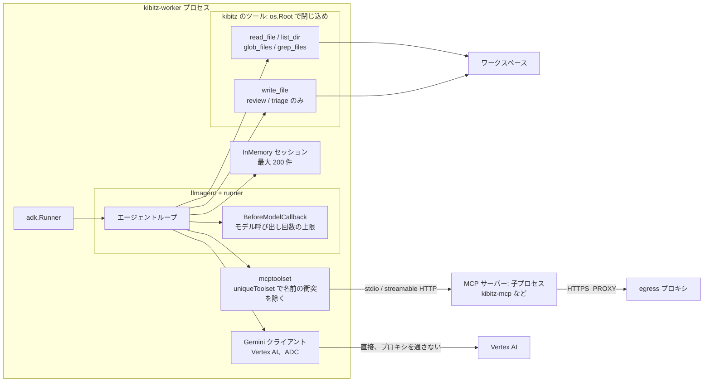

### 実行の流れ

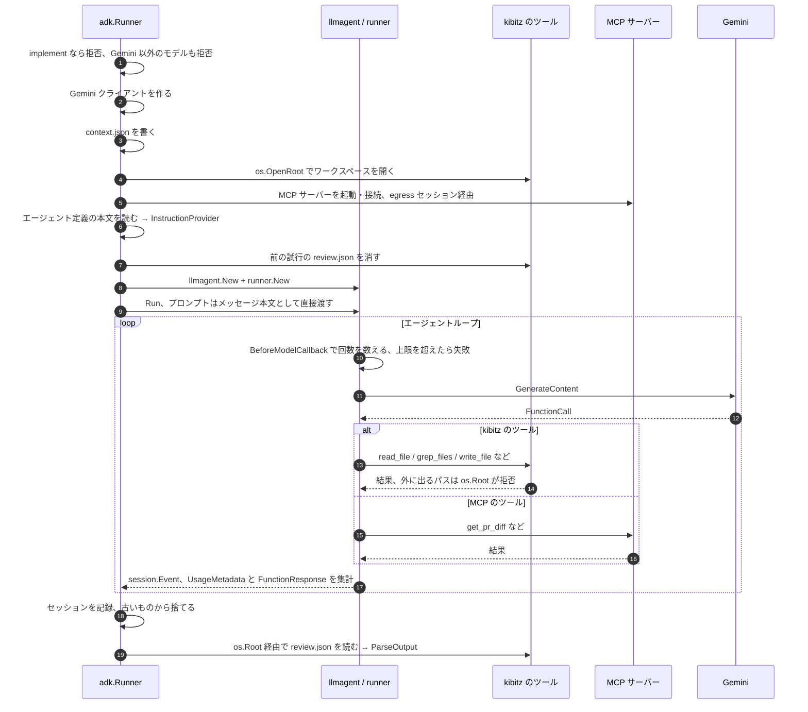

### モードごとのツール

| モード | 使えるツール | 書き込める場所 |
| --- | --- | --- |
| review / triage | `read_file` `list_dir` `glob_files` `grep_files` `write_file` | 出力ファイル 1 つだけ (`.kibitz/out/review.json` または `triage.json`) |
| answer / plan | `read_file` `list_dir` `glob_files` `grep_files` | なし (`write_file` を渡さない) |
| implement | (起動時に拒否) | — |

- ツール名が `read` ではなく `read_file` なのは、ADK が MCP のツール名に接頭辞を付けないため。
  付けないので、MCP サーバーの `read` とぶつかる。ぶつかったツールは、後から来た方を外して警告を出す。
- ツールの結果には上限がある (1 回の読み取りは 2,000 行・256 KiB、grep は 200 件など)。
  結果は以降の毎ターンで課金されるため。

### ほかの 2 つと違う点

- **プロンプト**: `.kibitz/prompt.md` を書かず、ユーザーメッセージの本文として直接渡す。
  システムプロンプトは OpenCode のエージェント定義 (`deploy/opencode/agents/*.md`) の本文で、3 エンジンで共通。
  `Instruction` ではなく `InstructionProvider` で渡すのは、`Instruction` がテンプレートとして解釈され、
  定義に含まれる JSON の `{}` が壊れるから。
- **egress**: プロキシを通るのは MCP サーバーの通信だけ。モデルへの通信は、worker 自身が設定どおりの宛先に、
  エージェントに見せない資格情報で行うものなので、プロキシを通さない。
- **チェックアウトの設定**: ADK は `AGENTS.md` も設定ファイルも読まない。止めるフラグが要らない。
- **暴走の歯止め**: `KIBITZ_ADK_MAX_MODEL_CALLS` (既定 100) を超えるとその回は失敗になる。
- **失敗の判定**: ループのエラー、またはイベントの `ErrorCode`。answer / plan で応答が空なら、終了理由と一緒に失敗にする。

## 6. 3 つの比較

| | OpenCode | pi | ADK |
| --- | --- | --- | --- |
| 実行形態 | 子プロセス `opencode run` | 子プロセス `pi --mode json` | worker 内 (ライブラリ) |
| 権限の作り方 | `permission` 設定 (allow / deny) | `defaultTools` + ガード拡張 | kibitz が書いたツールだけを渡す |
| ワークスペース外の拒否 | `external_directory: deny` | ガードがパスを解決して判定 | `os.Root` が開くときに拒否 |
| シェル | なし | なし | なし |
| チェックアウトの設定を読まない仕組み | `OPENCODE_DISABLE_PROJECT_CONFIG=1` | `--no-approve` ほか 3 つのフラグ | もともと読まない |
| プロンプトの渡し方 | `.kibitz/prompt.md` を `--file` で添付 | `.kibitz/prompt.md` を `@` で添付 | メッセージ本文 |
| システムプロンプト | `--agent kibitz-review` | `--append-system-prompt system.md` | `InstructionProvider` |
| 実行イベント | stdout の JSON | stdout の JSONL | `session.Event` |
| セッション | OpenCode の保存領域 / `--session` | `--session-dir` のファイル | メモリ (200 件) |
| モデル通信の egress | プロキシ経由 | プロキシ経由 | 直接 |
| 失敗からの回復 | セッション消失の再実行、打ち切りの再開 (2 回)、トークンの読み直し | なし | なし |
| モデル | 制限なし | 制限なし | Gemini のみ |
| 対応モード | すべて | すべて | implement 以外 |

3 つとも、出力の契約 (`.kibitz/out/review.json`)、MCP サーバーの選び方、子プロセスに渡す環境変数の絞り方
(許可リスト + MCP 定義が参照する変数だけ) は同じ。どのエンジンでも、エージェントの後で worker が同じ `Sanitize` を通す。

## 参照

- [agent-engine.md](agent-engine.md): エンジンの比較と選定、抽象化の契約
- [worker.md](worker.md): OpenCode のヘッドレス実行、MCP 統合、プロンプト設計
- [triage.md](triage.md): トリアージと 3 つの diff
- [security.md](security.md): プロンプトインジェクションと fork PR の扱い
- ADR: [0003](adr/0003-opencode-as-agent-engine.md) / [0024](adr/0024-keep-opencode-after-pi-gained-mcp.md) / [0025](adr/0025-trial-adk-go-as-an-in-process-engine.md)
